# Fix Problem Week 3 — Kelompok 3

1. Urutan Migration yang salah
* Masalah yang ditemukan : Pada folder database/migrations terdapat kesalahan dalam urutan migration, yaitu antara migration `2026_01_01_000001_create_courses_table.php` dan `2026_01_01_000002_create_users_table.php`. Yang dimana tabel `courses` dibuat sebelum tabel `users` dibuat, sedangkan pada migration `courses` terdapat potongan kode `$table->foreignId('lecturer_id')->constrained('users')` pembuatan tabel `courses` membutuhkan `users`. Namun hal ini berbanding terbalik dengan urutan migration, sehingga tabel `courses` dibuat sebelum tabel `users` dibuat.

* Risiko Keamanan/Dampak : Risiko yang terjadi jika urutan migration tidak dibenarkan adalah akan muncul error `SQLSTATE[HY000]: General error: 1824 Failed to open the referenced table 'users'` yang dimana disini SQL mencari tabel `users` saat akan membuat tabel `courses`, sedangkan tabel `users` sendiri secara urutan akan di eksekusi setelah tabel `courses` dibuat.
<p align="center">
  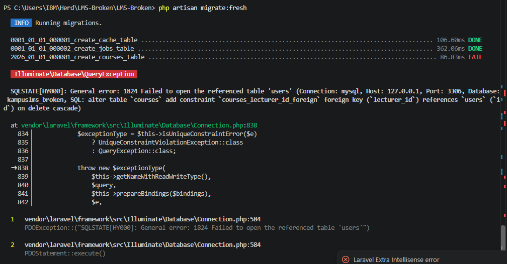
  <br>
  <b>Gambar 1 : Indikasi Error</b>
</p>


* Bukti pembetulan : Perbaikan yang saya lakukan adalah merubah urutan migration lewat nama filenya, berikut saya lampirkan sebelum saya merubah nama file dan setelah merubah nama file

<p align="center">
  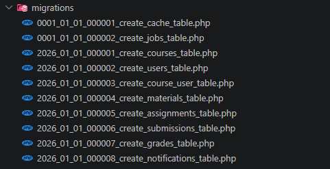
  <br>
  <b>Gambar 2 : Before perbaikan</b>
</p>

Pada posisi awal file migration `2026_01_01_000001_create_courses_table.php` untuk tabel `courses` dalam posisi ketiga dan file migration `2026_01_01_000002_create_users_table.php` untuk tabel `users` dalam posisi keempat.


<p align="center">
  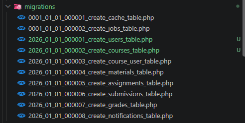
  <br>
  <b>Gambar 3 : After perbaikan</b>
</p>

Pada posisi akhir file migration `2026_01_01_000001_create_users_table.php` untuk tabel `users` dalam posisi ketiga dan file migration `2026_01_01_000002_create_courses_table.php` untuk tabel `courses` dalam posisi keempat.

<p align="center">
  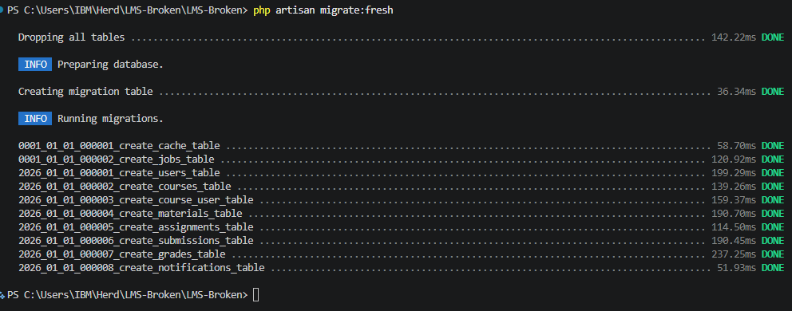
  <br>
  <b>Gambar 4 : Output akhir</b>
</p>

Sehingga saat saya menjalankan `php artisan migrate:fresh` migrations berjalan lancar

---

2. Composite Unique pada course_user
* Masalah yang ditemukan : Pada folder database/migrations terkhusus file migration bernama `2026_01_01_000003_create_course_user_table.php`, dalam file tersebut tidak terdapat constraint `unique` sehingga database tidak mencegah double data kombinasi course + user yang sama.

* Risiko Keamanan/Dampak : Risiko yang dapat terjadi adalah mahasiswa dapat mendaftar lebih dari satu kali sehingga duplikasi data terjadi.

* Bukti pembetulan : Perbaikan yang saya lakukan adalah menambah constraint `unique` berbentuk `$table->unique(['course_id', 'user_id']);` dalam file `2026_01_01_000003_create_course_user_table.php`.

<p align="center">
  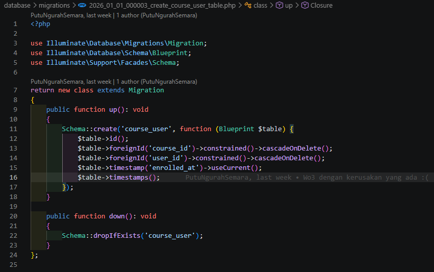
  <br>
  <b>Gambar 5 : Before perbaikan</b>
</p>

untuk penempatan constraint `unique` bisa diletakkan di sebelum maupun sesudah `timestamps()`, disini saya meletakkan di sesudah  `timestamps()` tepatnya di setelah `$table->timestamps();`

<p align="center">
  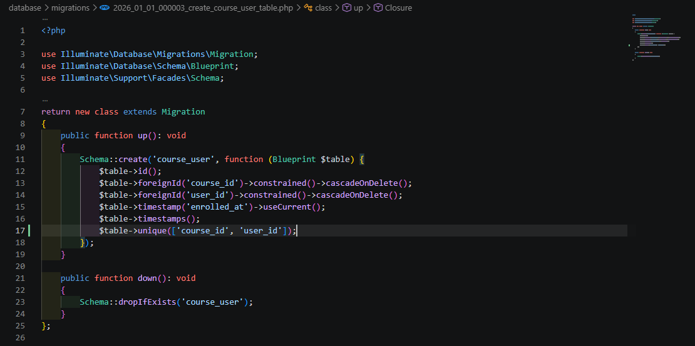
  <br>
  <b>Gambar 6 : After perbaikan</b>
</p>

lalu jalankan `php artisan migrate:fresh` agar migration direset oleh laravel

---

3. Composite Unique pada submissions
* Masalah yang ditemukan : Pada folder database/migrations terkhusus file migration bernama `2026_01_01_000006_create_submissions_table.php`, dalam file tersebut tidak terdapat constraint `unique` sehingga database tidak mencegah double data kombinasi assignment + user yang sama.

* Risiko Keamanan/Dampak : Risiko yang dapat terjadi adalah satu mahasiswa bisa mempunyai beberapa submission untuk tugas yang sama, sehingga data pengumpulan tugas menjadi ambigu dan jumlah submission bisa salah dan keliru.

* Bukti pembetulan : Perbaikan yang saya lakukan adalah menambah constraint `unique` berbentuk `$table->unique(['assignment_id', 'user_id']);` dalam file `2026_01_01_000006_create_submissions_table.php`.

<p align="center">
  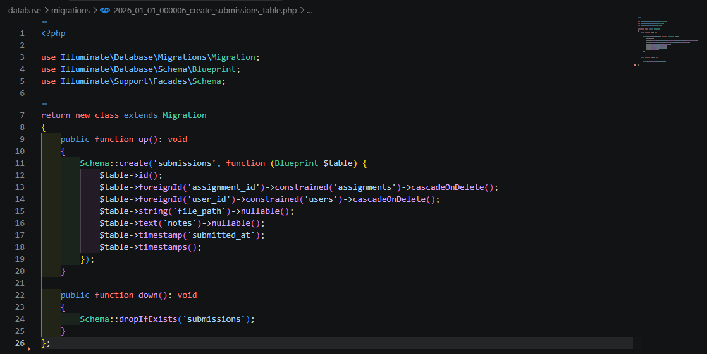
  <br>
  <b>Gambar 7 : Before perbaikan</b>
</p>

untuk penempatan constraint `unique` bisa diletakkan di sebelum maupun sesudah `timestamps()`, disini saya meletakkan di sesudah  `timestamps()` tepatnya di setelah `$table->timestamps();`

<p align="center">
  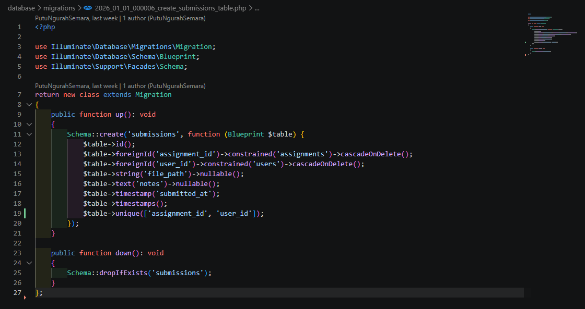
  <br>
  <b>Gambar 8 : After perbaikan</b>
</p>

lalu jalankan `php artisan migrate:fresh` agar migration direset oleh laravel

---

4. `onDelete` pada `materials` salah
* Masalah yang ditemukan : Pada folder database/migrations terkhusus file migration bernama `2026_01_01_000004_create_materials_table.php`, didalam file tersebut terdapat penggunaan constraint `restrictOnDelete()` pada foreign key `uploaded_by` yang mengacu ke tabel `users`. Hal ini membuat data `user` yang masih memiliki material tidak dapat dihapus karena masih digunakan sebagai foreign key.

* Risiko Keamanan/Dampak : Dampaknya adalah saat ingin menghapus `user` bisa gagal, dikarenakan user tersebut masih memiliki data materia dan hal ini bisa menghambat proses pengelolaan data `user`.

* Bukti pembetulan : Perbaikan yang saya lakukan adalah mengganti `restrictOnDelete()` menjadi `cascadeOnDelete()` pada field `uploaded_by` dalam file `2026_01_01_000004_create_materials_table.php`.

<p align="center">
  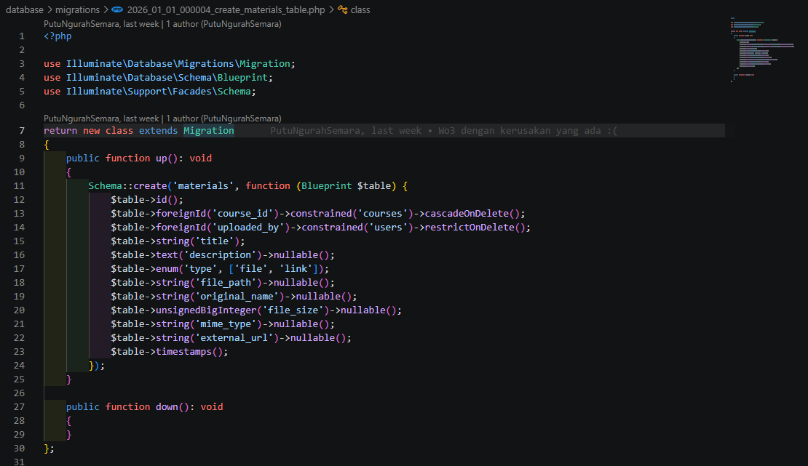
  <br>
  <b>Gambar 9 : Before perbaikan</b>
</p>

<p align="center">
  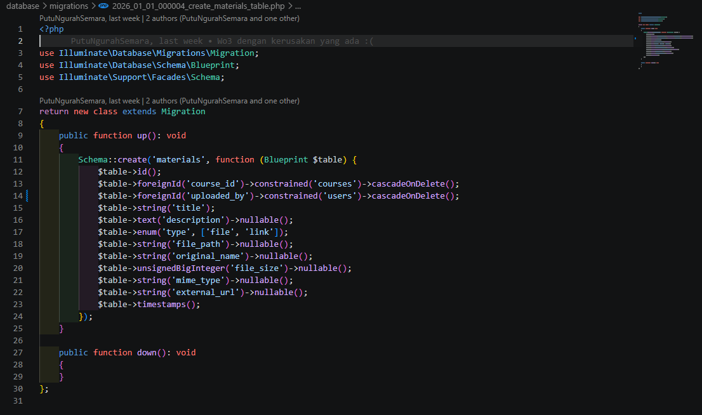
  <br>
  <b>Gambar 10 : After perbaikan</b>
</p>

lalu jalankan `php artisan migrate:fresh` agar migration direset oleh laravel

---

5. Perbaikan `$guarded = []`
* Masalah yang ditemukan : Pada file `app/Models/User.php` terdapat `protected $guarded = [];` yang dimana hal ini membuat semua atribut pada model `user` dapat diisi semua tanpa perlindungan `$fillable`.

* Risiko Keamanan/Dampak : Dampaknya adalah filed/kolom yang harusnya tidak bisa diubah user, bisa diisi oleh user melalui request. Hal ini sangat berbahaya apalagi field yang dapat diisi adalah `role`, karena user dapat mengubah data `role` apabila fielddikirim melalui form ataupun request

* Bukti pembetulan : Perbaikan yang saya lakukan adalah mengganti `protected $guarded = [];` menjadi `$fillable` pada file `app/Models/User.php`.

Contoh :
```php
protected $fillable = [
    'name',
    'email',
    'password',
    'nim_nip',
    'role',
];
```

<p align="center">
  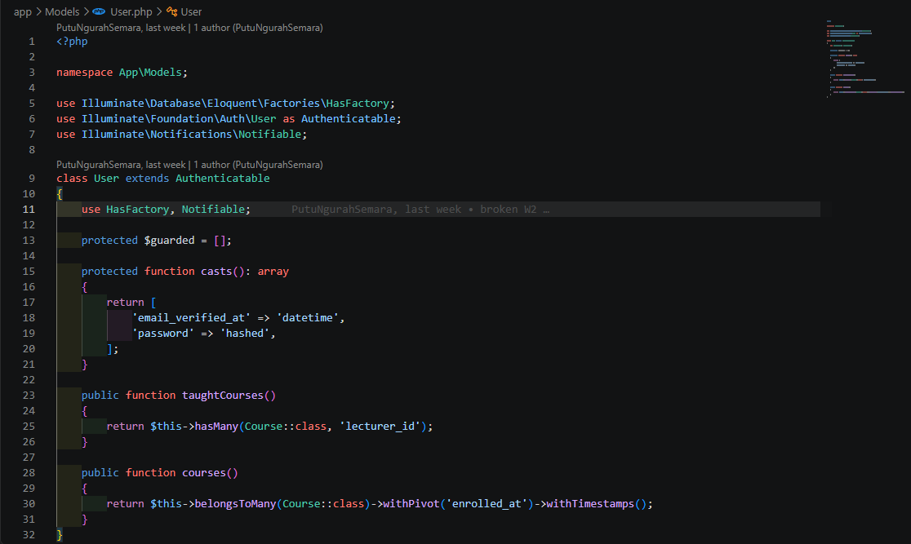
  <br>
  <b>Gambar 11 : Before perbaikan</b>
</p>

<p align="center">
  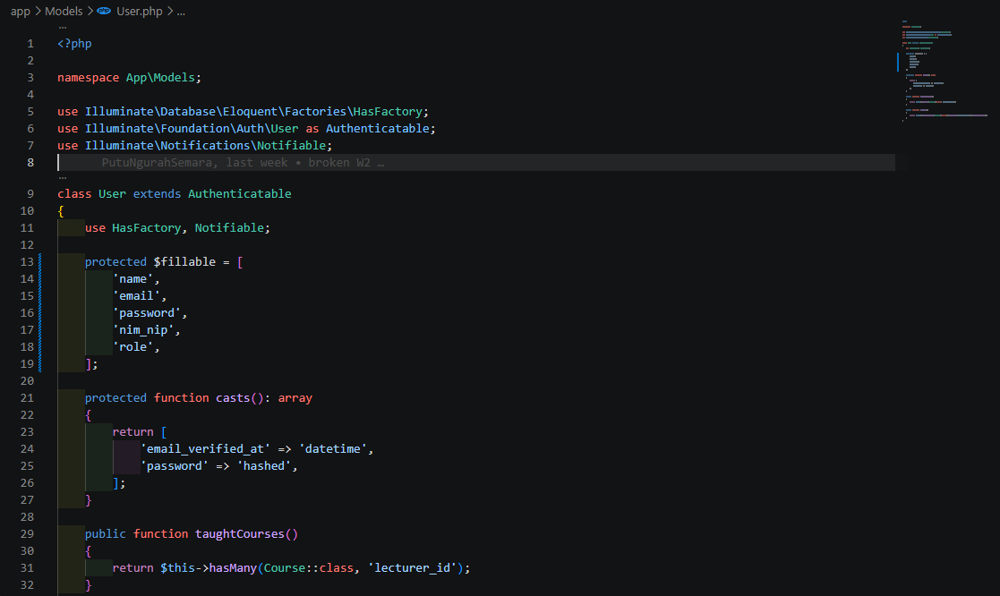
  <br>
  <b>Gambar 12 : After perbaikan</b>
</p>

---

6. `down()` kosong
* Masalah yang ditemukan : Pada file `2026_01_01_000004_create_materials_table.php` terdapat method `down()` yang tidak terisi, sehingga migration `materials` tidak memiliki proses untuk membatalkan sebuah perubahan.

* Risiko Keamanan/Dampak : Dampaknya adalah ketika rollback dilakukan, tabel `material` tetap berada di database walaupun proses migration dianggap sudah dibatalkan oleh Laravel. Hal tersebut membuat databasetidak sesuai dengan migration.

* Bukti pembetulan : Perbaikan yang saya lakukan adalah menambahkan `Schema::dropIfExists('materials');` pada method `down()` dalam file migration `2026_01_01_000004_create_materials_table.php`.

<p align="center">
  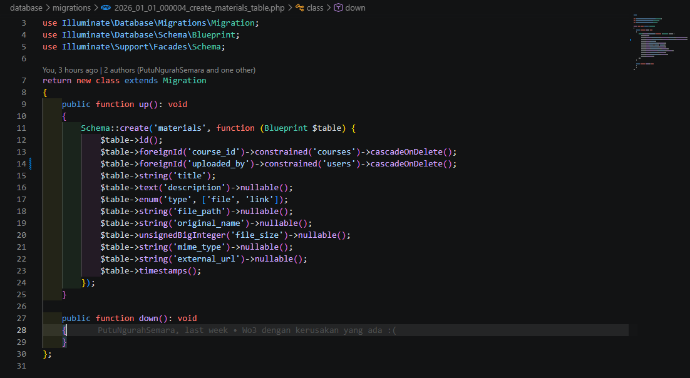
  <br>
  <b>Gambar 13 : Before perbaikan</b>
</p>

Method `down()` sebelumnya masih kosong dan tidak melakukan penghapusan tabel.

<p align="center">
  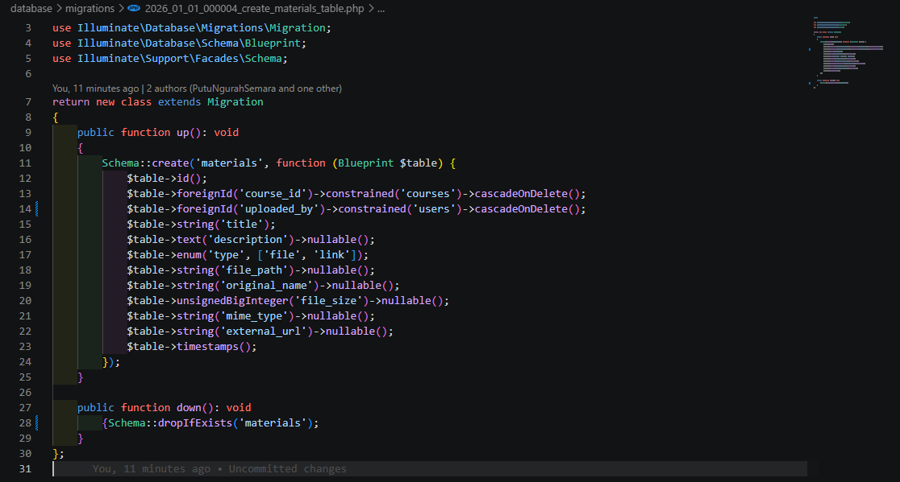
  <br>
  <b>Gambar 14 : After perbaikan</b>
</p>

Setelah diperbaiki, method `down()` akan menghapus tabel materials ketika migration di-rollback

---

7. UserController memakai `$request->all()`
* Masalah yang ditemukan : Pada file `app/Http/Controllers/UserController.php`, method `store()` dan `update()` masih menggunakan `$request->all()` untuk memproses data user. `$request->all()` mengambil seluruh data yang dikirim melalui request.

* Risiko Keamanan/Dampak : Dampaknya adalah data yang tidak seharusnya diproses dapat ikut diteruskan ke model. Hal ini dapat menyebabkan field yang tidak diinginkan ikut dibuat atau diubah melalui request.

* Bukti pembetulan : Perbaikan yang saya lakukan adalah melakukan validasi request terlebih dahulu menggunakan `$request->validate()`, kemudian menggunakan hasil validasi tersebut untuk proses `create()` dan `update()`.

<p align="center">
  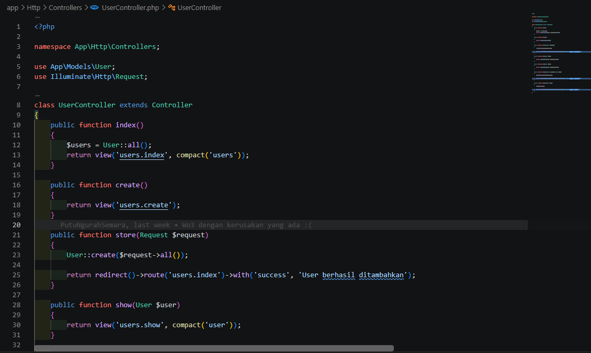
  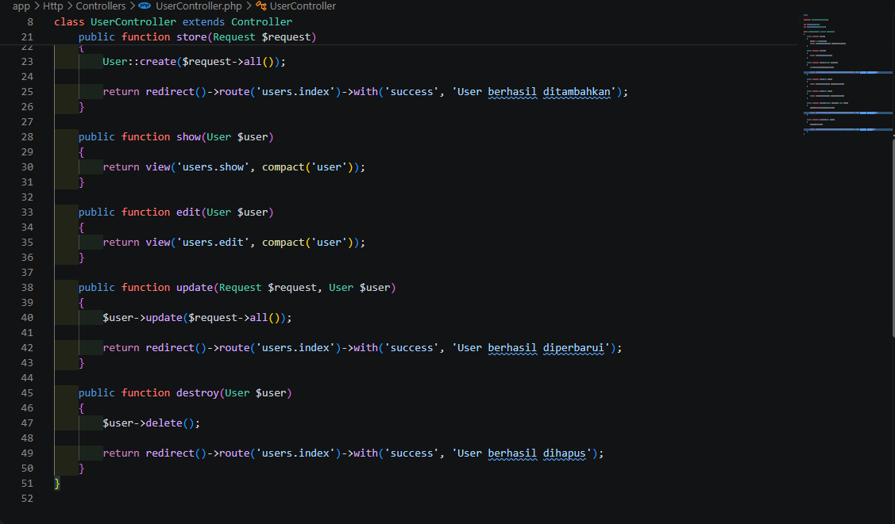
  <br>
  <b>Gambar 15 : Before perbaikan</b>
</p>

Memberikan fungsi pada `store()` untuk memberikan memvalidasi dan membatasi data yang boleh di proses

kode awal :
```php
    public function store(Request $request)
    {
        User::create($request->all());
        return redirect()->route('users.index')->with('success', 'User berhasil ditambahkan');
    }
```

kode akhir :
```php
    public function store(Request $request)
    {
        $validated = $request->validate([
            'name' => 'required',
            'email' => 'required|email|unique:users,email',
            'password' => 'required',
            'nim_nip' => 'nullable',
            'role' => 'required|in:admin,dosen,mahasiswa',
        ]);
        User::create($validated);
        return redirect()->route('users.index')
            ->with('success', 'User berhasil ditambahkan');
    }
```

Memberikan fungsi pada `update()` untuk memberikan memvalidasi dan membatasi data yang boleh di proses

kode awal :
```php
    public function update(Request $request, User $user)
    {
        $user->update($request->all());
        return redirect()->route('users.index')->with('success', 'User berhasil diperbarui');
    }
```

kode akhir :
```php
    public function update(Request $request, User $user)
    {
        $validated = $request->validate([
            'name' => 'required',
            'email' => 'required|email|unique:users,email,' . $user->id,
            'password' => 'nullable',
            'nim_nip' => 'nullable',
            'role' => 'required|in:admin,dosen,mahasiswa',
        ]);
        $user->update($validated);
        return redirect()->route('users.index')
            ->with('success', 'User berhasil diperbarui');
    }
```

<p align="center">
  
  <br>
  <b>Gambar 16 : After perbaikan</b>
</p>