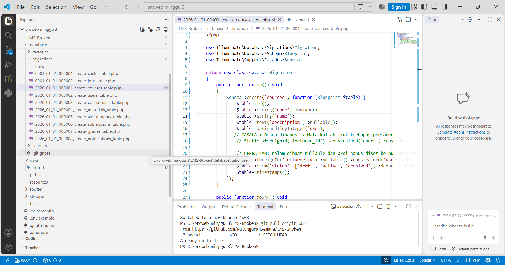
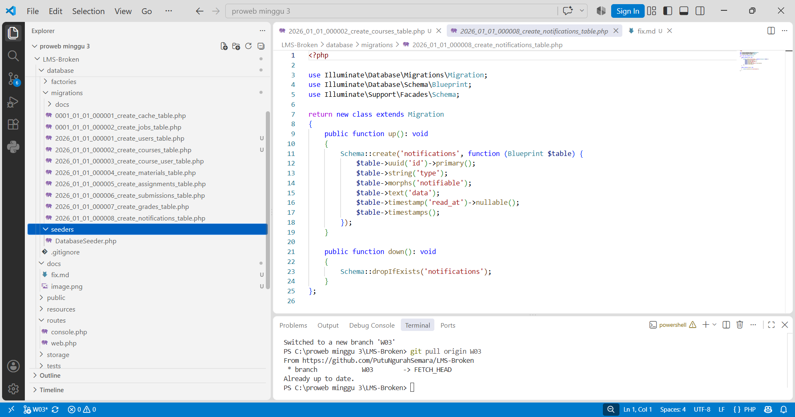

### - Urutan migrasi salah ( Putri Kelompok A-08 )

Laravel membaca dan menjalankan file migrasi secara berurutan (chronological order) berdasarkan timestamp pada nama filenya. Masalah terjadi karena file migrasi tabel `courses` berjalan lebih dulu sebelum tabel `users`. Karena tabel `courses` membutuhkan foreign key yang merujuk ke tabel `users` (kolom `lecturer_id`), sistem akan mengalami error Foreign key constraint is incorrectly formed saat proses migrasi dijalankan. Perbaikan yang dilakukan yaitu ubah nama file `courses` agar file `users` berada pada urutan pertama. Setelah diperbaiki, sistem bisa berjalan lancar tanpa error. Tabel `users` dibuat lebih dulu, jadi tabel `courses` bisa langsung terhubung ke tabel `users` tanpa masalah.

urutan File yang masih salah 

`2026_01_01_000002_create_courses_table.php` (berjalan duluan, error karena butuh users)
`2026_01_01_000003_create_users_table.php`

Urutan file yang benar

`2026_01_01_000001_create_users_table.php` (berjalan pertama)
`2026_01_01_000002_create_courses_table.php`

### - `onDelete` keliru ( Putri Kelompok A-08)

`cascadeOnDelete();` kode ini keliru karena jika data induk (data dosen) di hapus maka data anak (data matakuliah) yang terhubung akan otomatis ikut terhapus secara permanen dari database, disini relasi antara dosen dan mata kuliah diatur menggunakan cascade. Akibatnya jika ada data dosen yang dihapus makah seluruh mata kuliah yang di ampu dosen tersebut akan ikut terhapus. Perbaikan nya adalah mengganti menjadi `nullOnDelete`, sehingga jika akun dosen di hapus, data mata kuliah tetap aman dan tersimpan dan nama kolom dosen akan berubah menjadi `null`. Setelah perbaikan, Jika data dosen dihapus, maka data mata kuliah tetap aman tersimpan di database dan nilai kolom `lecturer_id` otomatis berubah menjadi NULL (kosong).

Kode sebelum perbaikan 
```
$table->foreignId('lecturer_id')->constrained('users')->cascadeOnDelete();
```
Kode setelah perbaikan
```
$table->foreignId('lecturer_id')->nullable()->constrained('users')->nullOnDelete();
```

### - unique composite hilang ( Sarah Kelompok A-08 )

- Pada file `2026_01_01_000003_create_course_user_table.php` aturan unique composite hilang. Tanpa aturan ini, mahasiswa (`user_id`) bisa mendaftar di mata kuliah (`course_id`) yang sama secara berulang kali sehingga datanya menjadi ganda di database. Menambahkan `$table->unique(['course_id', 'user_id']);` berfungsi sebagai pengaman di database, jika ada mahasiswa yang mencoba mendaftar ke mata kuliah yang sudah pernah di ambil, sistem akan menolak pendaftaran duplikat tersebut. Jika mahasiswa mencoba mendaftar ulang, database akan otomatis menolak input tersebut dan menghasilkan QueryException (error data ganda). Oleh karena itu, Controller perlu diberi validasi agar pesan error-nya bisa tampil dengan ramah di layar mahasiswa.

**unique composite yang hilang**

Kode sebelum perbaikan 
```
 public function up(): void
    {
        Schema::create('course_user', function (Blueprint $table) {
            $table->id();
            $table->foreignId('course_id')->constrained()->cascadeOnDelete();
            $table->foreignId('user_id')->constrained()->cascadeOnDelete();
            $table->timestamp('enrolled_at')->useCurrent();
            $table->timestamps();
        });
    }
```

Kode setelah perbaikan
``` 
 public function up(): void
    {
        Schema::create('course_user', function (Blueprint $table) {
            $table->id();
            $table->foreignId('course_id')->constrained()->cascadeOnDelete();
            $table->foreignId('user_id')->constrained()->cascadeOnDelete();
            // PERBAIKAN: Mencegah user mendaftar matkul yang sama berkali-kali
            $table->unique(['course_id', 'user_id']);
            $table->timestamp('enrolled_at')->useCurrent();
            $table->timestamps();
        });
    }
```

- Pada file `2026_01_01_000004_create_materials_table.php` Unique composite hilang, sehingga dosen bisa mengunggah dua materi dengan judul yang sama persis di dalam satu mata kuliah sehingga memicu duplikasi data di database. Kode di dalam fungsi down() yang kosongakan menyebabkan proses pembatalan migrasi (rollback) akan gagal atau tidak berdampak apa-apa saat dijalankan lewat terminal. Tambahkan perintah `Schema::dropIfExists('materials');` pada fungsi `down()`. Setelah itu, Perintah  php artisan migrate:fresh dapat menghapus tabel materials dengan bersih tanpa terhenti error.

**unique composite yang hilang**

Kode sebelum perbaikan 
```
public function up(): void
    {
        Schema::create('materials', function (Blueprint $table) {
            $table->id();
            $table->foreignId('course_id')->constrained('courses')->cascadeOnDelete();
            $table->foreignId('uploaded_by')->constrained('users')->restrictOnDelete();
            $table->string('title');
            $table->text('description')->nullable();
            $table->enum('type', ['file', 'link']);
            $table->string('file_path')->nullable();
            $table->string('original_name')->nullable();
            $table->unsignedBigInteger('file_size')->nullable();
            $table->string('mime_type')->nullable();
            $table->string('external_url')->nullable();
            $table->timestamps();
        });
    }
```

Kode setelah perbaikan 

```
 public function up(): void
    {
        Schema::create('materials', function (Blueprint $table) {
            $table->id();
            $table->foreignId('course_id')->constrained('courses')->cascadeOnDelete();
            $table->foreignId('uploaded_by')->constrained('users')->restrictOnDelete();
            $table->string('title');
            $table->text('description')->nullable();
            $table->enum('type', ['file', 'link']);
            $table->string('file_path')->nullable();
            $table->string('original_name')->nullable();
            $table->unsignedBigInteger('file_size')->nullable();
            $table->string('mime_type')->nullable();
            $table->string('external_url')->nullable();
            $table->timestamps();
            //Unique Composite untuk judul materi
            $table->unique(['course_id', 'title']);
        });
    }
```

**Mengisi fungsi down() untuk rollback**

Kode sebelum perbaikan 
```
 public function down(): void
    {
    }
};
```

Kode setelah perbaikan

```
    public function down(): void
    {
        Schema::dropIfExists('materials');
    }
};
```

### - $guarded = [] ( Fatim Kelompok A-08 )

Penggunaan protected `$guarded = [];` membuat seluruh kolom pada tabel users tidak dilindungi. Ini membuka celah di mana pengguna bisa memanipulasi data request (misalnya menyisipkan input role saat register) untuk mengubah peran mereka menjadi admin atau dosen secara tidak sah. Mengganti `protected $guarded = []` menjadi protected `$fillable = [...]` dengan mendefinisikan secara pasti kolom mana saja yang aman diisi dari input pengguna (seperti name, email, password, dan role). Aplikasi hanya akan memproses data input yang tercantum di dalam array `$fillable` saat melakukan operasi `User::create()` atau `User::update()`. Jika ada input ilegal yang disisipkan di luar daftar tersebut, Laravel akan otomatis mengabaikannya tanpa merusak jalannya sistem.

kode sebelum perbaikan

```
class User extends Authenticatable

    use HasFactory, Notifiable;
    protected $guarded = [];

```

kode setelah perbaikan

```
protected $fillable = [
    'name',
    'email',
    'password',
    'role',
];`
```

### satu controller yang memakai `$request->all().` ( Nazwa Kelompok A-08 )

Penggunaan `$request->all()` mengambil seluruh data input dari request tanpa proses validasi, hal ini akan berisiko memasukkan data manipulasi yang sengaja disisipkan oleh user, perbaikan nya mengganti pemanggilan `$request->all()` dengan `$request->validate([...])` untuk memastikan input diverifikasi dengan aman agar hanya file yang diizinkan saja yang diproses oleh controller. Lalu, Penggunaan `$request->all()` mengambil seluruh data input dari request tanpa proses validasi, hal ini akan berisiko memasukkan data manipulasi yang sengaja disisipkan oleh user, perbaikan nya mengganti pemanggilan `$request->all()` dengan `$request->validate([...])` untuk memastikan input diverifikasi dengan aman agar hanya file yang diizinkan saja yang diproses oleh controller.

kode sebelum perbaikan : 
```
public function store(Request $request)`
{
    User::create`($request->all());`

    return redirect()->back();`
}
```

kode setelah perbaikan : 
```
public function store(Request $request)
{
    
    $validated = $request->validate([
        'name' => 'required|string|max:255',
        'email' => 'required|email|unique:users,email',
        'password' => 'required|min:8',
        'role' => 'required|in:student,lecturer',
    ]);

  
    User::create($validated);

    return redirect()->back();
}
```

